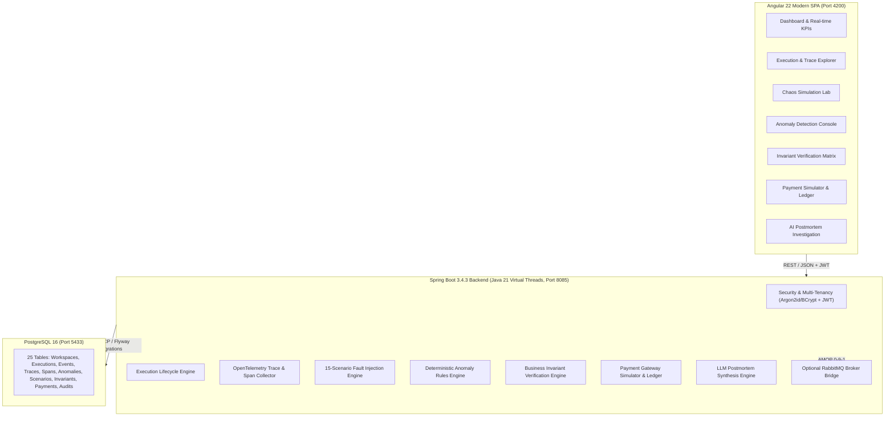

# ⚡ Workflow Reliability Lab (WRL)

<p align="center">
  
</p>

<p align="center">
  <strong>An enterprise-grade developer platform for simulating, testing, diagnosing, and mathematically verifying the reliability of distributed workflows and asynchronous systems.</strong>
</p>

<p align="center">
  <a href="https://github.com/harshalraajpatnaik/Workflow-Reliability-Lab/actions"></a>
  <a href="https://spring.io/projects/spring-boot"></a>
  <a href="https://angular.dev"></a>
  <a href="https://openjdk.org/projects/jdk/21/"></a>
  <a href="https://www.postgresql.org/"></a>
  <a href="https://opentelemetry.io/"></a>
  <a href="LICENSE"></a>
</p>

---

## 📌 Executive Overview

Modern cloud architectures rely on microservices communicating asynchronously over message brokers (Kafka, RabbitMQ, SQS) and event-driven sagas (Temporal, Camunda). While distributed architectures provide horizontal scalability, they introduce **chaotic failure modes** that traditional observability tools (Datadog, Grafana, Sentry) cannot diagnose:

- **At-Least-Once Redeliveries:** A network timeout between a broker and worker causes duplicate execution. Did your payment gateway double-charge the user?
- **Out-of-Order Lifecycle Events:** A `ShipmentDelivered` webhook arrives before the `PaymentCaptured` event due to cloud routing latency. Did your system fulfill an unpaid order?
- **Ghost Retries & Idempotency Leaks:** A client times out and retries with a new correlation key, bypassing deduplication tables.
- **Partial Saga Failures:** Step 1 and Step 2 succeed, but Step 3 fails. Did compensating transactions cleanly execute, or is customer money orphaned in a limbo state?

**Workflow Reliability Lab** bridges this critical gap. It is not an orchestrator or an APM replacement; it is a **purpose-built testing, simulation, and invariant verification platform** that empowers engineering teams to simulate disasters under controlled conditions and mathematically prove their distributed workflows remain resilient.

---

## 🏛️ System Architecture



---

## 🚀 The 4 Core Capabilities

### 1. 🔍 Execution Observability & Trace Waterfalls
- Visual chronological event timeline tracking every lifecycle mutation (`OrderCreated`, `PaymentCaptured`, `StockReserved`).
- Deep OpenTelemetry trace waterfall showing span latency, client/server boundaries, and error tags.
- Dynamic microservice dependency graph computing call rates and error concentrations.

### 2. 🧪 Controlled Failure Simulation (15 Chaos Scenarios)
- Built-in failure injector capable of simulating real-world distributed disasters at the click of a button.
- Tests downstream timeouts, database pool exhaustion, broker queue backpressure, worker SIGKILL crashes, poison pills, and concurrent optimistic locking conflicts.

### 3. 🛡️ Deterministic Invariant Verification Engine
- Mathematical assertions that must hold true across every single execution.
- If an execution completes, the engine rigorously verifies that:
  - $\text{Total Refunded} \le \text{Total Captured}$ (Refund Ceiling).
  - No customer charge occurred more than once for a single checkout session (Zero Double-Charge).
  - No state transition occurred twice on non-retry events (Zero Duplicate Transitions).
  - Terminal states (`COMPLETED`, `CANCELLED`, `FAILED`) are strictly immutable.

### 4. 🧠 Incident Investigation & Automated AI Postmortems
- Evidence-backed incident declaration when invariant breaches or critical anomalies concentrate.
- Automated AI Assistant aggregates span errors, failed event payloads, and timestamps into a structured root-cause analysis and actionable remediation advice.
- One-click postmortem generation formatted for executive and engineering review.

---

## ⚡ Built-in Failure Simulation Catalog

The platform includes **15 pre-configured chaos scenarios** ready to run immediately:

| Scenario Code | Scenario Name | Category | Fault Injected | Expected System Behavior |
|---|---|---|---|---|
| `SCEN_NET_TIMEOUT` | Downstream Network Timeout | Network | 8200ms socket latency on HTTP client | Circuit breaker trips; fails fast with fallback |
| `SCEN_SERVICE_503` | Upstream Dependency Unavailable | Service | Upstream returns HTTP 503 Service Unavailable | Exponential backoff retry with jitter |
| `SCEN_DB_TIMEOUT` | DB Connection Pool Exhaustion | Database | HikariCP pool saturation under lock contention | Graceful queueing or fast-fail backpressure |
| `SCEN_WORKER_CRASH` | Async Worker Sudden Crash | Compute | SIGKILL mid-saga execution before event ack | Message redelivery to standby worker node |
| `SCEN_DUP_MESSAGE` | Duplicate Message Ingestion | Messaging | Broker redelivery of identical payload | Idempotency layer suppresses duplicate side effect |
| `SCEN_DELAYED_MESSAGE`| Delayed Message Delivery | Messaging | 45-minute broker queue backpressure delay | Out-of-order reconciliation or TTL expiration |
| `SCEN_OUT_OF_ORDER` | Out-of-Order Lifecycle Sequencing | Messaging | Step 3 (`Shipped`) arrives before Step 2 (`Paid`)| Pipeline holds or rejects un-sequenced state |
| `SCEN_RETRY_STORM` | Thundering Herd / Retry Storm | Resilience | 50 workers retry failed service simultaneously | Jittered exponential backoff prevents outage |
| `SCEN_POISON_MESSAGE`| Malformed Poison Pill Payload | Messaging | Invalid JSON schema causing Jackson parse error | Poison pill isolated to Dead Letter Queue (DLQ) |
| `SCEN_DEAD_LETTER` | Dead-Letter Queue Re-routing | Messaging | Message exhausts 5 retry attempts | Routed to DLQ with diagnostic error attributes |
| `SCEN_PARTIAL_SAGA_FAIL`| Saga Mid-Flight Failure | Workflow | Step 3 fails after Step 1 & 2 succeed | Compensating transactions refund and rollback |
| `SCEN_PAYMENT_TIMEOUT` | Gateway Timeout on Charge Capture | Payment | Gateway charge call times out with unknown state| Reconcile pending state against gateway ledger |
| `SCEN_WEBHOOK_DUP` | Duplicate Payment Webhook Delivery| Payment | Provider delivers `charge.succeeded` 3 times | Idempotent webhook handler executes once |
| `SCEN_WEBHOOK_DELAY` | Webhook Arrives Before Redirect | Payment | Webhook arrives before browser return | State journal reconciles race condition |
| `SCEN_DB_CONFLICT` | Optimistic Locking Version Clash | Database | Concurrent mutation triggers version conflict | Automatic retry on OptimisticLockException |

---

## 📐 Invariant Verification Rules Matrix

| Invariant Code | Name | Mathematical / Logical Expression | Description |
|---|---|---|---|
| `INV_NO_DOUBLE_CHARGE` | Zero Double Charge | $\sum \text{ChargeEvents}(e) \le 1$ | Guarantees a customer is never billed more than once per checkout session. |
| `INV_REFUND_CEILING` | Refund Ceiling | $\sum \text{Refunds} \le \sum \text{Captured}$ | Mathematical guarantee that refunds cannot exceed total money captured. |
| `INV_NO_DUP_TRANSITION` | No Duplicate Transition | $\forall (s_1, s_2), \text{Count}(\text{Transition}(s_1 \rightarrow s_2)) \le 1$ | State transitions cannot recur unless explicitly flagged as a retry. |
| `INV_TERMINAL_IMMUTABILITY` | Terminal State Lock | $\forall t > t_{\text{terminal}}, \Delta \text{State} = \emptyset$ | A completed or cancelled workflow rejects subsequent mutations. |
| `INV_COMPENSATION_LOGGED` | Saga Rollback Audit | $\text{ExecutionFailed} \implies \text{Logged}(\text{Compensate})$ | Any aborted distributed transaction must journal compensating steps. |
| `INV_JOURNAL_MATCH` | State Journal Consistency | $\text{Terminal}(\text{Execution}) \equiv \text{LastEvent}(\text{Timeline})$ | Workflow engine status must match the final domain event status. |
| `INV_RECONCILIATION_BAL`| Ledger Parity | $\text{InternalLedger}(\text{Net}) == \text{Gateway}(\text{ChargeNet})$ | Balance verification between internal ledger and external gateway. |
| `INV_REQUIRED_STEPS` | Required Lifecycle Steps | $\text{Steps}(e) \supseteq \{\text{Created}, \text{Processed}, \text{Finalized}\}$ | Completed workflows must execute mandatory lifecycle phases. |

---

## 🛠️ Technology Stack

| Layer | Technologies |
|---|---|
| **Frontend** | Angular 22 (Standalone Components, Signals, Reactive Forms), TailwindCSS, Lucide Icons, KaTeX |
| **Backend** | Spring Boot 3.4.3, Java 21 LTS (Virtual Threads enabled), Spring Security 6, Spring Data JPA, Flyway |
| **Database** | PostgreSQL 16 (JSONB column types for flexible telemetry and evidence journaling) |
| **Observability** | OpenTelemetry Trace & Span Ingest specification, W3C TraceContext standard |
| **Messaging** | Optional RabbitMQ (AMQP 0-9-1) connector with live credential and connection health validator |
| **Authentication** | BCrypt password hashing, Stateless JWT access tokens, SameSite HTTP-only refresh tokens, Role-Based Access Control (RBAC) |
| **DevOps & Containers** | Docker, Docker Compose, MailHog SMTP mock sandbox |

---

## ⚡ Quick Start Guide

### Prerequisites
- **Java 21 LTS** (`openjdk@21`)
- **Node.js 20+** and **npm**
- **Docker** and **Docker Compose**
- **Maven 3.9+** (or use included `./mvnw`)

### 1. Clone & Start Infrastructure
```bash
git clone https://github.com/harshalraajpatnaik/Workflow-Reliability-Lab.git
cd Workflow-Reliability-Lab

# Start PostgreSQL 16 and MailHog mock SMTP server
docker-compose up -d
```

### 2. Launch Spring Boot Backend
```bash
cd backend
mvn clean package -DskipTests
java -jar target/workflow-reliability-lab-backend-1.0.0-SNAPSHOT.jar
# Backend will start on http://localhost:8085
```

### 3. Launch Angular 22 Frontend
```bash
cd ../frontend
npm install
npx ng serve --port 4200
# Web portal will start on http://localhost:4200
```

### 4. Access the Platform
- Open **`http://localhost:4200`** in your browser.
- Click **Sign In** and use the pre-seeded Enterprise Demo account:
  - **Email:** `lead.architect@workflowlab.dev`
  - **Password:** `Password123!@#`

---

## 🔌 Integrating Your Own Applications

### Ingesting an OpenTelemetry Span via REST
```bash
curl -X POST http://localhost:8085/api/v1/workspaces/{WORKSPACE_ID}/traces/spans \
  -H "Authorization: Bearer YOUR_API_KEY" \
  -H "Content-Type: application/json" \
  -d '{
    "traceId": "4bf92f3577b34da6a3ce929d0e0e4736",
    "spanId": "00f067aa0ba902b7",
    "serviceName": "order-service",
    "name": "POST /orders/checkout",
    "spanKind": "SERVER",
    "statusCode": "OK",
    "startTimeUs": 1730300000000000,
    "endTimeUs": 1730300000045000,
    "attributes": "{\"http.status_code\": 200, \"customer.tier\": \"gold\"}"
  }'
```

### Emitting an Asynchronous Workflow Event
```bash
curl -X POST http://localhost:8085/api/v1/workspaces/{WORKSPACE_ID}/events \
  -H "Authorization: Bearer YOUR_API_KEY" \
  -H "Content-Type: application/json" \
  -d '{
    "executionId": "8b6d13a4-71cf-458c-adeb-1486fc4322ab",
    "eventType": "PaymentCaptured",
    "sourceService": "payment-gateway",
    "targetService": "order-service",
    "correlationId": "ord-corr-9921",
    "idempotencyKey": "idem_pay_9921_01",
    "status": "PROCESSED",
    "retryCount": 0,
    "payloadMeta": "{\"amount\": 199.99, \"currency\": \"USD\", \"provider\": \"Stripe\"}"
  }'
```

---

## 📁 Repository Directory Structure

```
Workflow-Reliability-Lab/
├── backend/                  # Spring Boot 3.4.3 Core Application
│   ├── src/main/java/        # Clean Architecture modules (Auth, Execution, Event, Trace,
│   │                         # Anomaly, Scenario, Invariant, Payment, Incident, Integrations)
│   ├── src/main/resources/   # DB Migrations (Flyway V001..V019), application.yml
│   └── pom.xml               # Maven Dependencies & Compiler Specs
├── frontend/                 # Angular 22 Modern SPA
│   ├── src/app/              # Standalone Components, Reactive Signals, Directives, Guards
│   │   ├── core/             # Auth interceptors, guards, and HTTP service facades
│   │   ├── pages/            # Dashboard, Executions, Traces, Anomalies, Scenarios,
│   │   │                     # Invariants, Payments, Incidents, Integrations, Audit
│   │   └── shared/           # Navigation, header, modals, and reusable components
│   └── package.json          # Angular 22 & Tailwind dependencies
├── docs/                     # Comprehensive Architecture & Beginner Documentation
│   └── PORTAL_GUIDE_AND_EXPLANATION.md # Complete step-by-step novice guide
├── sdk/                      # Developer Integration SDKs (Java, Python)
├── docker-compose.yml        # PostgreSQL 16 & MailHog services
├── test_all_apis.py          # Automated verification test suite (100% pass)
└── LICENSE                   # Apache License 2.0
```

---

## 🔒 Security & Threat Model

- **Authentication:** Password storage using BCrypt with salt rounds; short-lived access JWTs paired with secure HTTP-only SameSite refresh token cookies.
- **Tenant Isolation:** Multi-tenancy strictly enforced at the database query level; workspace IDs verified on every transaction.
- **API Key Security:** Machine keys generated using `SecureRandom` 256-bit cryptoprimes; stored exclusively as SHA-256 hashes.
- **Audit Trails:** Immutable database logging of all authentication events, scenario runs, payment mutations, and key revocations.

---

## 🤝 Contributing

Contributions are welcome! Please read our [CONTRIBUTING.md](CONTRIBUTING.md) and [CODE_OF_CONDUCT.md](CODE_OF_CONDUCT.md) for details on code standards, pull request processes, and test requirements.

---

## 📄 License

This project is licensed under the Apache License, Version 2.0. See the [LICENSE](LICENSE) file for details.

```
Copyright 2026 Harshal Raaj Patnaik

Licensed under the Apache License, Version 2.0 (the "License");
you may not use this file except in compliance with the License.
```
