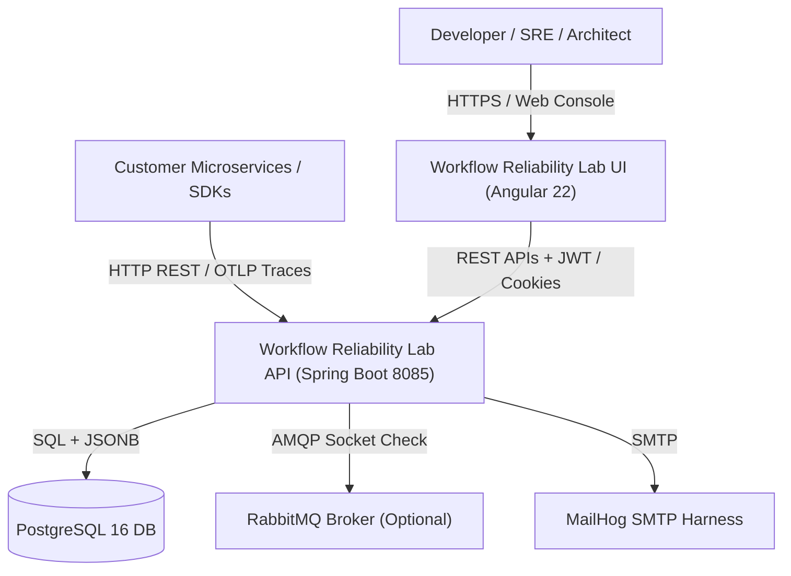
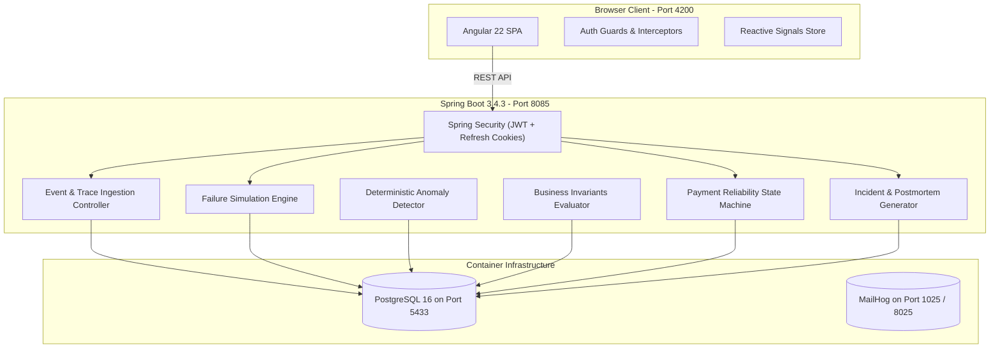

# System Architecture & C4 Model — Workflow Reliability Lab

## 1. High-Level Architecture Overview
Workflow Reliability Lab is built on a clean three-tier distributed architecture:
- **Presentation Tier:** Angular 22 Single Page Application (SPA) using TypeScript, reactive Signals, standalone components, and dark developer-tool design system.
- **Application Tier:** Java 25 / Spring Boot 3.4.3 REST API with Spring Security, Spring Data JPA, and Flyway database migrations.
- **Data Tier:** PostgreSQL 16 relational database with native `JSONB` support for schema-flexible event journals, trace spans, and anomaly evidence.
- **External Integration Bridges:** OpenTelemetry OTLP receiver, optional RabbitMQ AMQP bridge with AES-256 encrypted credential storage, and MailHog SMTP test harness.

---

## 2. C4 Context Diagram (System Context)

---

## 3. C4 Container Diagram (Platform Containers)

---

## 4. Key Architectural Patterns
- **Transactional Outbox / Journaling:** Events are written durably with unique idempotency keys before downstream notification dispatch.
- **Tenant Context ThreadLocal:** `TenantContext` extracts workspace identifiers from request headers, route paths, or API keys, ensuring multi-tenant isolation across all database queries.
- **Idempotency Gate:** Checks incoming idempotency keys against the database; duplicate submissions return existing execution results without re-triggering side effects.
- **Microsecond Clock:** Traces and span intervals use microsecond timestamps (`startTimeUs`, `endTimeUs`) to calculate accurate waterfall spans.
