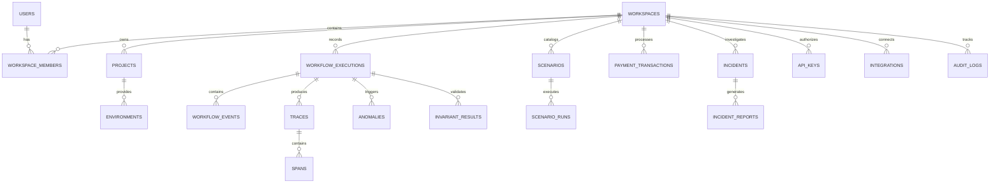

# Database Schema & Entity-Relationship Model

## 1. Migration Overview
The database uses Flyway migrations (V001 through V018) located in `backend/src/main/resources/db/migration/`:
- `V001__users.sql`: Users and credentials.
- `V002__workspaces.sql`: Workspaces and tenant root entities.
- `V003__workspace_members.sql`: RBAC memberships (`OWNER`, `ADMIN`, `DEVELOPER`, `VIEWER`).
- `V004__projects_and_environments.sql`: Project hierarchies and environment configurations.
- `V005__workflow_executions.sql`: Workflow execution state machine tracking.
- `V006__workflow_events.sql`: Durable event journal with idempotency keys.
- `V007__traces_and_spans.sql`: OpenTelemetry traces and spans with microsecond timestamps.
- `V008__anomalies.sql`: Detected anomaly records and deterministic evidence JSONB.
- `V009__failure_scenarios.sql`: 15 built-in chaos scenarios.
- `V010__scenario_runs.sql`: Scenario simulation audit trail.
- `V011__invariant_definitions.sql`: 8 formal invariant specifications.
- `V012__invariant_results.sql`: Execution invariant verification checks.
- `V013__payment_simulations.sql`: Financial transactions, webhooks, and ledger entries.
- `V014__incidents.sql`: Incident cases, root-cause hypotheses, and markdown postmortem reports.
- `V015__api_keys.sql`: SHA-256 hashed workspace API keys (`wrl_...`).
- `V016__integrations.sql`: Integration configurations (RabbitMQ with AES-256 encrypted passwords).
- `V017__audit_and_webhooks.sql`: Immutable security audit log and outgoing webhooks.
- `V018__seed_demo_data.sql`: Seed data for immediate local demonstration.

---

## 2. Entity-Relationship Diagram

---

## 3. High-Performance Indexing Strategy
- `idx_events_exec_seq`: B-Tree index on `(execution_id, sequence_number)` for chronological event replay.
- `idx_events_idem_key`: Unique index on `(workspace_id, idempotency_key)` preventing duplicate side-effects.
- `idx_spans_trace_parent`: Index on `(trace_id, parent_span_id)` enabling rapid waterfall hierarchy rendering.
- `idx_exec_workspace_status`: Compound index on `(workspace_id, status)` for fast dashboard queries.
- `idx_api_keys_hash`: Hash index on `key_hash` for constant-time API token authentication.
