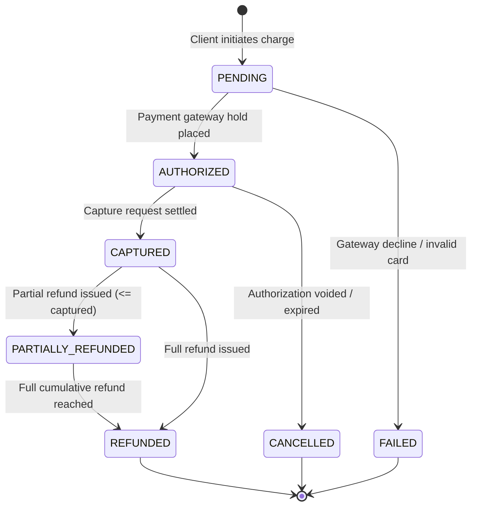

# Financial State Machine & Reconciliation Architecture

Financial workflows require non-negotiable guarantees against data corruption, duplicate charges, and over-refunding. Workflow Reliability Lab embeds an isolated financial simulation engine implementing double-entry accounting models.

---

## 1. Formal Payment State Machine

---

## 2. Invariant Enforcement Mechanisms

### A. Idempotency Key Deduping
Every payment initiation and webhook arrival must present an idempotency key:
- If key is new: Store key atomically with transaction status `PENDING`.
- If key was previously observed: Reject re-execution and return existing transaction record.

### B. Refund Ceiling Guard (INV-005)
When a refund is submitted:
1. Load payment transaction with pessimistic database row lock (`SELECT ... FOR UPDATE`).
2. Verify:
   $$\text{txn.refundedAmount} + \text{requestedRefund} \le \text{txn.capturedAmount}$$
3. If violated: Reject with HTTP 422 Unprocessable Entity and record invariant failure in `invariant_results`.

### C. Double-Entry Ledger Reconciliation
- Every transaction creates paired balanced ledger entries:
  - Account Debit: Cash / Gateway Clearing
  - Account Credit: Customer Accounts Receivable
- Reconciliation job scans ledger entries and confirms that net balance across all accounts is zero.
